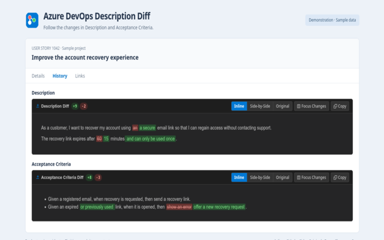

# Azure DevOps Description Diff

[](https://addons.mozilla.org/en-US/firefox/addon/azure-devops-description-diff/)

A lightweight browser extension for **Google Chrome**, **Mozilla Firefox**, **Microsoft Edge**, and **Brave** that adds **inline diffs** for **Description** and **Acceptance Criteria** in Azure DevOps Work Item History.

The extension highlights word-level additions and deletions in each supported field. Each revision has independent Inline, Side-by-Side, Original, Focus Changes, and Copy controls.

**Current version:** 1.0.3

**Released:** 22 October 2026

**Firefox add-on ID:** `ado-description-diff@dawiisss`



## ✨ Features

- **⚡ Inline Word-by-Word Diffs**: Added text is highlighted in soft green (`+`), removed text is highlighted in soft red with strikethrough (`-`).
- **🔀 Three View Modes on Every Change**:
  - **Inline Diff** (Default): Unified view showing additions and deletions in-place.
  - **Side-by-Side (Split)**: Synchronized previous vs. current columns with highlights.
  - **Original**: Instant 1-click toggle back to the native Azure DevOps view.
- **🔍 "Focus Changes" Mode**: For long multi-paragraph descriptions where only a few words changed, collapses unchanged sections so you can immediately see the modification.
- **📋 One-Click Copy**: Copy the updated field text directly to clipboard.
- **📊 Change Statistics**: Displays word change counters (`+15`, `-3`) for each supported field revision.
- **🌙 Dark Mode & Light Mode**: Automatically adapts to Azure DevOps themes.
- **🔄 Live Revision Switching**: Smoothly re-computes diffs when clicking through revisions in the left timeline.
- **🔒 Local Diff Processing**: Computes description diffs in your browser without uploading descriptions or sending telemetry or analytics. See the privacy details below for browser sync and embedded resources.
- **🏢 On-Premise Support**: Works out-of-the-box on `dev.azure.com` and `*.visualstudio.com`, with optional per-site access to custom on-premise TFS / Azure DevOps Server hosts through the Options page.

---

## 🔒 Privacy & Data Handling

- **No changes to Azure DevOps data:** The extension only changes how the History page is displayed in your browser. It does not edit or save work items, descriptions, revisions, or comments. Disabling it restores the original display.
- **No field uploads or telemetry:** Description and Acceptance Criteria text is processed locally to calculate diffs. The extension has no upload, telemetry, or analytics calls.
- **Preferences may sync:** Settings and custom hostnames use the browser's extension sync storage when available, falling back to local extension storage. They may sync through your browser account. Field text is not stored in either storage area.
- **Embedded resources may make requests:** Images in generated views can load from their original servers. The original Azure DevOps description can also contain embedded resources. Local diff processing does not mean zero network activity.
- **Safe rich-text rendering:** Bundled DOMPurify sanitizes descriptions before diffing and sanitizes the generated views again before display or copying. Formatting, tables, links, and images are supported; scripts, event handlers, unsafe URLs, inline styles, forms, SVG, and embedded frames are removed from the generated views.
- **Clipboard access is user-initiated:** Clicking **Copy** writes the current field text to your clipboard.

Read the [privacy policy](PRIVACY.md), also available through the packaged [privacy page](privacy.html).

---

## 🚀 Installation Guide

### Install on Mozilla Firefox

1. Open the [Azure DevOps Description Diff listing on Firefox Add-ons](https://addons.mozilla.org/en-US/firefox/addon/azure-devops-description-diff/) in Firefox.
2. Click **Add to Firefox** and approve the requested permissions.
3. Open an Azure DevOps work item and click the **History** tab.

### Load a development copy

The steps below load a development copy. Download or clone the project first. The bundled sanitizer is included in `content/vendor/`, so loading the extension or opening the demo does not require installing development dependencies.

#### Option A: Google Chrome / Microsoft Edge / Brave

1. Open your browser and navigate to `chrome://extensions` (or `edge://extensions`).
2. Enable **Developer mode** (toggle switch in the top-right corner).
3. Click **Load unpacked** in the top-left corner.
4. Select the project folder containing `manifest.json`.
5. The extension is now active! Open any Azure DevOps work item and click the **History** tab.

---

#### Option B: Mozilla Firefox

1. Open Firefox and navigate to `about:debugging#/runtime/this-firefox`.
2. Click **Load Temporary Add-on...**.
3. Select the Firefox-specific `dist/ado-description-diff-firefox.zip` from the built packages.
4. The extension will appear in your installed temporary extensions list and start functioning immediately.

Firefox removes temporary add-ons when it restarts. For a permanent installation in standard Firefox, use the [published Firefox Add-ons release](https://addons.mozilla.org/en-US/firefox/addon/azure-devops-description-diff/). The ZIP produced by this project's packaging command is unsigned until Mozilla signs it. The Firefox package requires Firefox 128 or later; Chrome requires version 109 or later. Use the Firefox-specific ZIP because the root manifest uses Chrome's service worker configuration. The automated browser tests run in Chromium.

---

## Browser Permissions

- **Storage:** Saves whether the extension is enabled, the default view, Focus Changes preference, and custom hostnames. Browser sync storage is preferred when available.
- **Scripting:** Registers and injects bundled scripts/styles on approved custom servers.
- **Cloud site access:** Required HTTPS access is limited to `dev.azure.com` and `*.visualstudio.com`.
- **Optional custom-site access:** Options requests access to the specific server the user connects. Saved preferences alone do not grant browser access, and removing a site revokes its optional permission.
- **Firefox data declaration:** The Firefox manifest contains `data_collection_permissions.required: ["none"]`. There are no description-upload, telemetry, or analytics calls; browser-managed preference sync and embedded images are described above.

---

## 🖥️ Live Preview & Demo

You can test and preview the extension's behavior without opening Azure DevOps:

Open `demo/testbed.html` in any web browser:
```bash
# In Firefox:
firefox demo/testbed.html

# Or in Chrome / default browser:
xdg-open demo/testbed.html
```

The testbed includes:
- A realistic mock of the Azure DevOps Work Item History tab.
- Revisions with Description changes.
- Dark mode toggle button.
- Revision switcher button (simulates clicking between Revision 2 and Revision 3).

---

## 🧪 Running Tests

The tests cover the diff engine, native History markup for both fields, sanitization, clipboard behavior, original-content restoration, permission handling, and packaged archives. Browser regressions additionally cover rendered visibility, preferences, themes, and the standalone demo.

Use Node.js 20 or later and npm to install development dependencies.

```bash
npm ci
# Unit, DOM, and site-permission checks without Chromium or built ZIPs:
npm run test:unit
# Build fresh archives and check their contents:
npm run test:package
# Browser regressions:
npx playwright install chromium
npm run test:browser
# Run only the diff-engine unit tests:
node --test tests/diff.test.js
```

Set `CHROMIUM_PATH` to use an installed Chromium executable. The standalone demo also works without extension storage.

Packaging and store-image commands require the local, Git-ignored `scripts/` and `store-listing/` release resources, also included in the reviewer source archive. See [CONTRIBUTING.md](CONTRIBUTING.md) for build instructions, output ZIPs, and the release checklist.

---

## 📁 Project Structure

| Path | Purpose |
| --- | --- |
| `manifest.json` / `manifest.firefox.json` | Chrome manifest and Firefox-specific overrides. |
| `content/` | Diff engine, History observer, bundled DOMPurify, and widget styles. |
| `background/` / `shared/` | Custom-host validation and permission-aware script registration. |
| `popup/` / `options/` | Toolbar controls, preferences, and site-access prompts. |
| `icons/` | Extension icons and vector source. |
| `demo/` | Interactive testbed and sample-data store preview. |
| `docs/images/` | Screenshots displayed in this README. |
| `tests/` | Diff, DOM, permission, package, and browser regressions. |
| `package-extension.js` | Packaging entry point for the local release tools. |
| `package.json` / `package-lock.json` | Development commands and dependency versions. |
| `CONTRIBUTING.md` | Development and release workflow. |
| `CHANGELOG.md` | Version history and release notes. |
| `PRIVACY.md` / `privacy.html` | Public and packaged privacy policies. |
| `LICENSE` | Project license and attribution. |

`dist/`, `scripts/`, and `store-listing/` are local release resources ignored by Git for new additions.

---

## ⚙️ Custom On-Premise Domains

If your organization hosts an internal Azure DevOps Server or Team Foundation Server (TFS):

1. Click the extension icon in your browser toolbar and click **Custom Domains & Options** (or right-click the extension icon and choose **Options**).
2. Enter a hostname or HTTP/HTTPS URL (e.g. `tfs.mycompany.com` or `https://devops.internal`). Addresses without a scheme use HTTPS. URL paths are ignored; browser host access covers all ports and paths at that hostname.
3. Click **Connect Site** and approve the browser's permission request for that server.
4. The extension activates on the approved site. Declining access does not save or activate it.

Approved domain changes apply to already-open top-level pages when possible; refresh already-open embedded work-item frames. Removing a domain revokes optional access and restores the original view. Synced custom sites without a local browser grant display **Grant access**. Older broad grants are removed on upgrade; reconnect custom servers if prompted.

---

## 📜 License

Licensed under the [MIT License](LICENSE).

Copyright (c) 2026 dawiisss (K3to).

Bundled third-party components retain their own licenses:
- **htmldiff.js**: Copyright (c) 2014 The Next Web, based on work by Ian Bicking. Licensed under the [MIT License](https://opensource.org/licenses/MIT).
- **DOMPurify**: Copyright (c) 2024 Mario Heiderich, Cure53. Licensed under the [Apache-2.0 License](content/vendor/DOMPurify-LICENSE) (or MPL-2.0).
